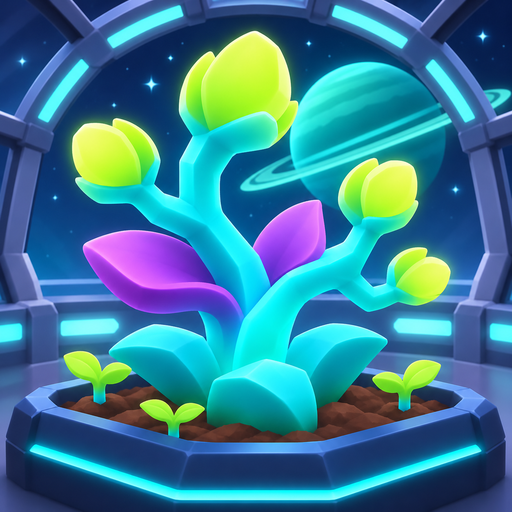
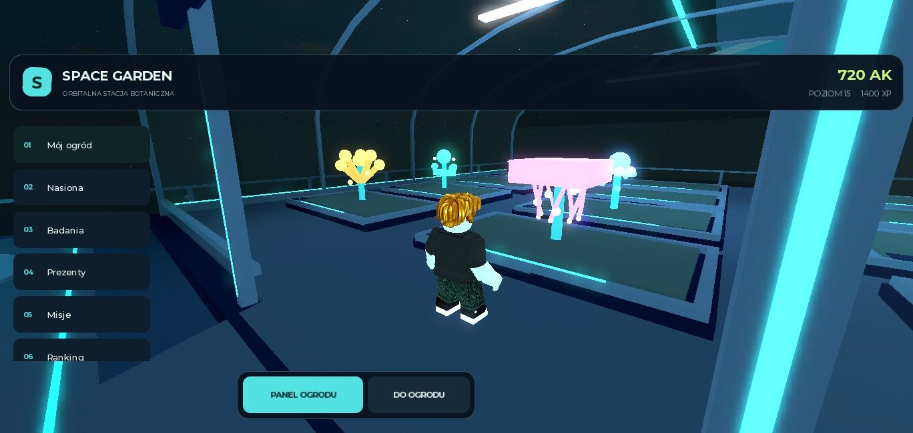
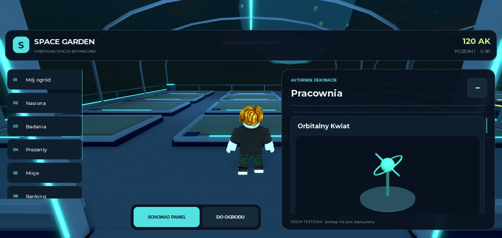
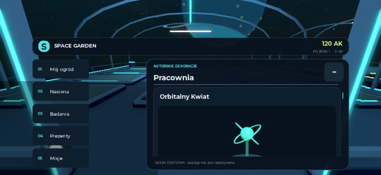

<p align="center">
  
</p>

<h1 align="center">Space Garden</h1>

<p align="center">
  <a href="https://www.roblox.com/games/101257030687266/Space-Garden"><b>Play on Roblox</b></a>
</p>

Space Garden is a multiplayer farming game for Roblox, set on an orbital greenhouse station. Each player gets a private greenhouse with up to 12 hydroponic beds, grows six alien plant species, researches upgrades, designs decorative sculptures and contributes to a shared monthly challenge across all servers. Crops keep growing while the player is offline.

The game is published and playable on desktop, phone and tablet. All gameplay logic, persistence, monetization and UI are written in Luau; the station itself is generated from code at server start, with no imported meshes or external assets. In-game text is in Polish.

| Gameplay | Design studio (Pracownia) |
| --- | --- |
|  |  |

<p align="center">
  
  
</p>

Screenshots were taken in Roblox Studio with a QA profile. The store icons were drawn as SVG for the four paid offers.

## Gameplay systems

- **Greenhouses.** A server hosts up to 6 players, each assigned one greenhouse with 12 beds. 4 beds are open at the start; research and the ExtraBeds pass unlock more, capped at 12.
- **Six crop species.** Cosmo, Lunar, Prism, Solar, Nebula and Void unlock at levels 1 to 12, with growth times from 25 seconds to 18 minutes. Each species has its own procedurally built silhouette and three visible growth stages; ripe plants glow and emit particles.
- **Plant, water, harvest.** Interaction runs through ProximityPrompts on each bed (keyboard, touch or gamepad). Watering shortens the remaining growth once per crop, with a cooldown. Growth is timestamp-based, so crops mature while the player is away.
- **Economy and progression.** Astral Credits, XP and levels; a seed shop; a research tree with three branches (growth speed, extra beds, yield bonus) and exponential costs.
- **Daily and monthly loops.** Daily reward with a streak bonus, a daily harvest quest, a personal monthly challenge and a galaxy-wide monthly challenge (10,000 harvests summed across all servers; a player must contribute 8 harvests to claim the reward).
- **Leaderboards.** Per-server leaderstats and a global lifetime harvest ranking.
- **Friend gifts.** Once a day a player can send one seed to a Roblox friend on the same server; both receive a credit bonus.
- **Design studio.** Players compose sculptures from 4 shapes, 5 palettes and a 0.7 to 1.4 scale, preview them in a 3D ViewportFrame, keep 3 designs and place them on 3 stands in their greenhouse. Designs can be shared through UUID codes (up to 3 publications per day) and imported by other players.
- **Themes.** Three station themes recolor the greenhouse accents.
- **Monetization.** Two developer products (SeedPack, GrowthBoost) and two game passes (ExtraBeds, StarterPack). The client shows the player's regional price fetched from `MarketplaceService:GetProductInfoAsync`.
- **Responsive UI.** One client script builds the whole interface in code, adapts layout to the viewport (landscape, portrait, compact), supports touch and gamepad navigation, and has an in-game reduced-motion toggle.

## Technical highlights

**Server-authoritative design.** The client talks to the server through a single `RemoteFunction`. Every action has an allowlisted argument schema (unknown fields are rejected), integers are checked for NaN, infinity and range, and a token bucket limits request rate per player. Prices, rewards and growth times are computed only on the server; the client receives a state snapshot.

**DataStore persistence with session locking.** Profiles are written with `UpdateAsync` under a session lease (unique token plus expiry). A second server cannot load or overwrite a profile while another server holds a valid lease; if a write discovers the lease was taken, the player is disconnected instead of overwriting newer data. Loaded data passes through a sanitizer that clamps values and drops malformed fields, and unknown future schema versions are refused. Autosave runs every 45 seconds and `BindToClose` flushes all profiles within a deadline.

**Purchases via MarketplaceService, validated on the server.** `ProcessReceipt` waits (bounded to 5 seconds) for any in-flight save to finish, re-checks that the profile is still the live, durably leased one, then writes the reward and the `PurchaseId` in the same `UpdateAsync` before returning `PurchaseGranted`. Replayed receipts are recognized and not granted twice; any failure returns `NotProcessedYet` so Roblox retries. Game passes are granted by a retrying worker, and purchase prompts that would give no benefit (ExtraBeds at full capacity or already owned) are rejected before prompting.

**Exactly-once gifts across two profiles.** Gifting is a small saga: the sender's reservation is persisted first (outbox), delivery to the recipient is idempotent by gift ID (online or offline, respecting the recipient's lease), and the sender bonus is committed only after delivery. Pending gifts are replayed on rejoin and survive timeouts on either side.

**Global counters without `IncrementAsync`.** The monthly challenge uses a fixed radix-128 tree of DataStore records. Servers submit absolute per-player checkpoints and records take the maximum, so retries, timeouts and out-of-order servers cannot double-count. Pending work and read frequency are bounded, and the ranking uses an `OrderedDataStore` with cached username lookups.

**Shareable design codes.** Published designs are immutable records keyed by UUID. Quota and code are reserved in the player's profile before publication (outbox pattern), so a failed or timed-out publication is retried without spending another daily slot. Imports are re-validated against the allowlisted catalog, cached with negative caching, and guarded by DataStore request budget checks.

**Bounded rendering.** Decorations are rendered on the server from an allowlisted schema, within a 320-part budget, as anchored geometry with collisions, touch and queries disabled. Unchanged designs are not rebuilt.

**Studio safety.** In Studio the game uses session-only profiles: paid grants, gifts, external design codes and global rewards fail closed. A test API (`_G.SpaceGardenTest`) is exposed only in Studio and only on the server; no debug remotes are shipped.

## Testing

The project has **199 checks in 9 suites**. Most suites are `RunTests` functions that live next to the code they test and use in-memory DataStore fakes with injected failures (outages, timeouts after commit, lost leases), so no live data is touched.

| Suite | Checks | Where it lives | Runs in |
| --- | ---: | --- | --- |
| Gameplay (planting, watering, harvest, shop, research, daily/quest/season, input validation, throttling) | 51 | `tests/studio/GameplayQA.luau` | Studio |
| Design studio integration (save/place/remove, remote schema, 20 shape/palette render budgets) | 37 | `tests/studio/CreatorIntegrationQA.luau` | Studio |
| Gift persistence (saga, outages, timeouts, leases, value clamping) | 16 | `SpaceGardenServer.server.luau` | Studio |
| Design code workflow (quota, outbox, retries, imports) | 15 | `SpaceGardenServer.server.luau` | Studio |
| Receipt readiness (purchase gating, lease and departure checks) | 11 | `SpaceGardenServer.server.luau` | Studio |
| Global reward (exactly-once claim, rollover) | 11 | `SpaceGardenServer.server.luau` | Studio |
| Global progress (radix tree, idempotency, multi-server, caching) | 20 | `SpaceGardenGlobal.luau` | Studio and Luau CLI |
| Design codes (UUID, immutability, caching) | 12 | `SpaceGardenBlueprints.luau` | Studio and Luau CLI |
| Design validation (schema, scale, sanitizer) | 26 | `SpaceGardenDecorations.luau` | Studio and Luau CLI |

**Luau CLI (58 checks).** The three engine-independent suites run outside Roblox with the standalone [Luau CLI](https://github.com/luau-lang/luau/releases). A small Python script wraps each module with stubs for the few engine globals it touches at load time and runs its `RunTests` function unchanged:

```
python tests/cli/run_cli_tests.py --luau path/to/luau
```

```
ok    GlobalProgress (monthly counters, ranking): 20 checks
ok    Blueprints (shareable design codes): 12 checks
ok    Decorations (design validation): 26 checks

58 checks passed, 0 suite(s) failed
```

**Roblox Studio (all 199 checks).** Start a Play session, then from the server command bar call the suites exposed by the server script, for example `_G.SpaceGardenTest.RunPersistenceTests()`, and run the two QA modules from `tests/studio` with `require(module)(_G.SpaceGardenTest, player)`. The release QA log for version 1.2 records all 199 checks passing (2026-11-02 baseline, 2026-11-04 release regression).

## Project structure

Files mirror the Roblox instance hierarchy of the published place.

```
src/
  ReplicatedStorage/SpaceGarden/
    Config.luau                       shared catalog: seeds, research, themes, economy constants
    DecorCatalog.luau                 frozen catalog of sculpture shapes and palettes
    SpaceGardenClient.client.luau     Script with RunContext = Client; whole UI and input
  ServerScriptService/
    SpaceGardenServer.server.luau     gameplay, persistence, purchases, gifts, Studio test API
  ServerStorage/
    SpaceGardenWorldBuilder.luau      procedural station: promenade, 6 greenhouses, beds, lighting
    SpaceGardenDecorations.luau       design validation, profile sanitizer, bounded renderer
    SpaceGardenBlueprints.luau        immutable shareable design records
    SpaceGardenGlobal.luau            cross-server monthly counters and global ranking
tests/
  studio/                             QA modules run inside a Studio Play session
  cli/run_cli_tests.py                Luau CLI runner for engine-independent suites
docs/images/                          screenshots and icons
```

The place file itself is not included. Apart from the scripts above it only holds Lighting settings and an `InputContext` at `ReplicatedStorage.Inputs.SpaceGarden` with two actions: `TogglePanel` (G, gamepad Y) and `HarvestAll` (H, gamepad RB).

## Tech stack

- **Luau** with Roblox engine services: DataStoreService (including OrderedDataStore), MarketplaceService, ProximityPrompt, InputActionSystem, TweenService, ViewportFrame, ConfigService (optional live tuning with an explicit key allowlist)
- **Testing:** self-contained check-based suites with injected DataStore fakes (no external test framework), run in Roblox Studio and, for engine-independent modules, in the standalone Luau CLI
- **Tooling:** Python for the CLI test harness

## Author

Maciej Kaczmarczyk ([mkaczmarczyk.com](https://mkaczmarczyk.com))

## License

All rights reserved, shared as a portfolio project.
